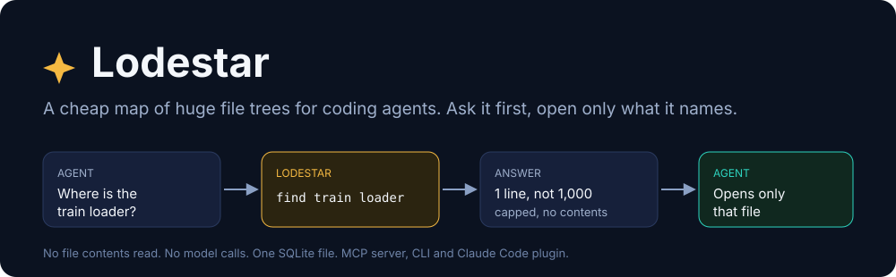
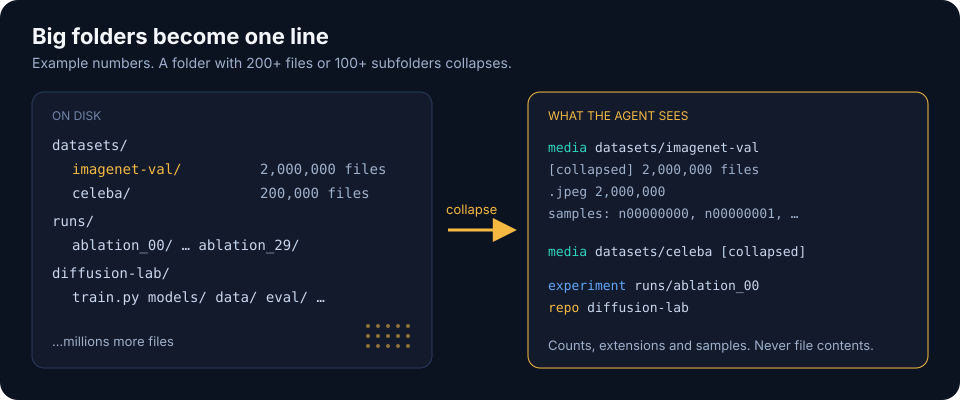
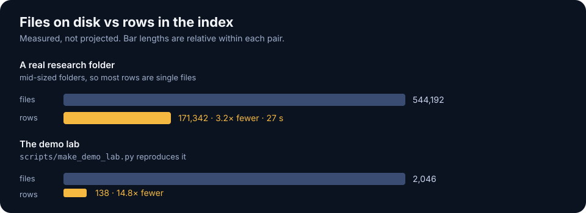
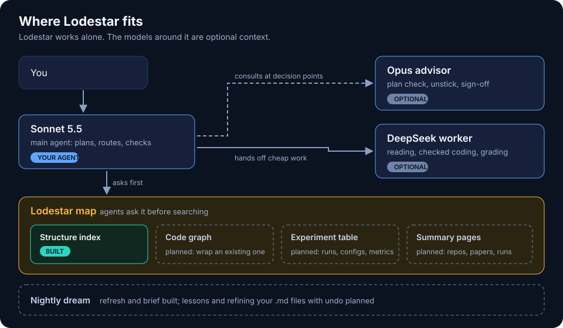

<div align="center">



[](https://github.com/alimohammadiamirhossein/lodestar/actions/workflows/ci.yml)
[](LICENSE)
[](pyproject.toml)
[](https://modelcontextprotocol.io/)


</div>

**Lodestar is an MCP server, a Claude Code plugin and a small CLI that gives coding agents a cheap
map of a huge file tree.** It indexes the roots you name into one SQLite file. Agents ask the map
first and open only the files it names, instead of grepping and listing folders.

It never reads file contents and never calls a model.

> Status: alpha. The structure index and the queries work and CI is green on Linux, macOS and
> Windows. **Not measured yet:** how many tokens it saves an agent against plain Glob and Grep.
> The code graph, experiment table and nightly consolidation in [docs/design.md](docs/design.md)
> are not built.

## What an agent sees

A real run on the demo tree from [scripts/make_demo_lab.py](scripts/make_demo_lab.py) (paths
shortened):

```text
$ lodestar index lab-demo
lab-demo: ok, 2,046 files, 138 nodes, 72 dirs scanned, 0 reused, 0.0s

$ lodestar find train loader
file     lab-demo/diffusion-lab/data/train_loader.py  400 B

$ lodestar find imagenet
media      lab-demo/datasets/imagenet-val  [collapsed] 480 files, ~93.8 KB

$ lodestar find ablation --kind experiment --limit 2
experiment lab-demo/runs/ablation_00  [dir] 2 files, 5.0 KB
experiment lab-demo/runs/ablation_01  [dir] 2 files, 5.0 KB

$ lodestar info lab-demo/datasets/imagenet-val
media: lab-demo/datasets/imagenet-val
480 files in 120 subdirectories, ~93.8 KB
extensions: .jpeg 480
samples: n00000000, n00000001, n00000002
collapsed: individual entries are not indexed; list the folder to see more
```

## How it works



- **Collapsing.** A folder with 200 or more files, or 100 or more subfolders, becomes one entry
  with its file count, size estimate, extension counts and a few sample names.
- **Kinds.** Folders are labelled `repo` (has `.git`), `experiment` (TensorBoard events, `.hydra`,
  `wandb`), `dataset`, `checkpoints`, `media`, `docs` or `dir`.
- **Search.** SQLite FTS5 over names, paths, kinds and notes, with prefix matching.
- **Incremental.** An unchanged collapsed folder (same mtime) is kept without rescanning. Deleted
  paths leave the index. `--full` rescans everything; `--max-seconds` stops early and keeps a
  partial index without deleting anything.
- **Known limit.** A collapsed folder is reused when its own mtime is unchanged, and a folder's
  mtime does not change when files are added deeper down. Counts under a folder collapsed for
  having many subfolders can therefore go stale until `lodestar index --full` runs; schedule it
  weekly.
- **Bounded answers.** Every query returns a capped list of short lines.
- **Shared machines.** You name the roots. A root owned by another user is refused unless you
  pass `--allow-foreign`, and that choice is remembered for refreshes. Symlinks are not followed,
  other filesystems are skipped, and caches, `.git` and `node_modules` are pruned. File names are
  indexed, so a file called `.env.bak` shows up by name; its contents are not read.

## Measured so far



The research folder is a Windows laptop folder indexed cold in 27 seconds. Most of its rows are
individual files in mid-sized folders, so the saving there is about 3x in rows. The big gains come
from huge flat folders, like the demo's image datasets. Token savings for agents are not measured.

Search results are tidied before an agent sees them: a folder that matched only because something
inside it did is dropped (`find jpg` lists `datasets/faces`, not also `datasets/` and the root), and
more than three matching files in one folder fold into a single "N matches in ..." line.

## Where it fits



Lodestar is one layer of a larger plan for cheaper, smarter agents on a shared lab server. It has
no dependency on any other part and works alone. See [docs/design.md](docs/design.md).

## Install

```bash
pip install -e .          # PyPI release not published yet
lodestar index ~/projects ~/datasets
lodestar find train loader
```

As a Claude Code plugin:

```bash
claude plugin marketplace add alimohammadiamirhossein/lodestar
claude plugin install lodestar@lodestar
```

Or add the server by hand: `claude mcp add lodestar -- lodestar serve`.

The index lives in `~/.lodestar/index.db` (override with `LODESTAR_HOME`).

## Commands and tools

| CLI | MCP tool | Does |
|---|---|---|
| `lodestar index [roots]` | `reindex` | Build or refresh the index. The tool only refreshes roots you indexed before. |
| `lodestar find words` | `find` | Search; `--kind` filters |
| `lodestar tree PATH` | `tree` | Indexed children of a folder, biggest first |
| `lodestar info PATH` | `info` | Kind, counts, size, extensions, sample names |
| `lodestar stats` | `stats` | What is indexed and when |
| `lodestar serve` | | Run the MCP server on stdio |

[scripts/survey.sh](scripts/survey.sh) is a read-only survey of a server: disk, tools, repos,
experiment markers and file counts per top-level folder.

## Roadmap

- [x] Structure index with collapsing, kinds, incremental refresh
- [x] `find`, `tree`, `info`, `stats`; CLI, MCP server, plugin and skill
- [ ] Benchmark against plain Glob and Grep on a large tree
- [x] Group search hits by parent
- [ ] Tag sensitive file names
- [ ] Experiment table filled from configs and logs
- [ ] Code graph, wrapping an existing tool
- [ ] Nightly refresh and consolidation

## Develop

```bash
python -m pip install -e ".[dev]"
python -m pytest -q
```

MIT licensed.
